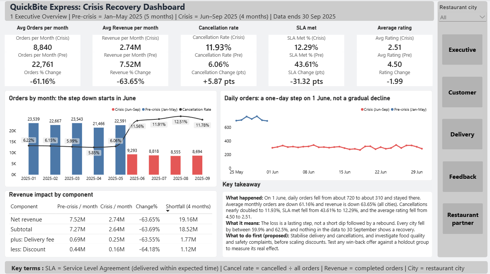
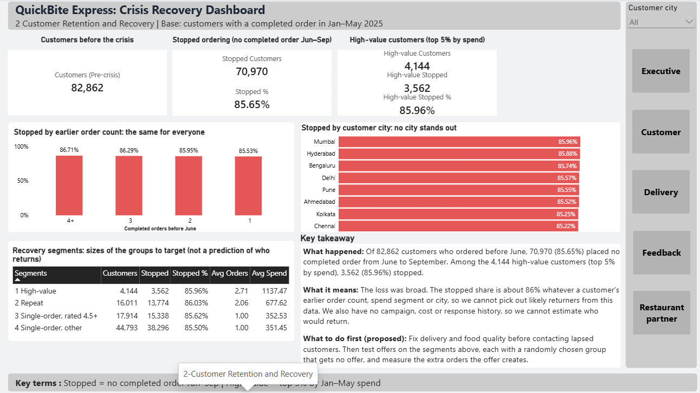
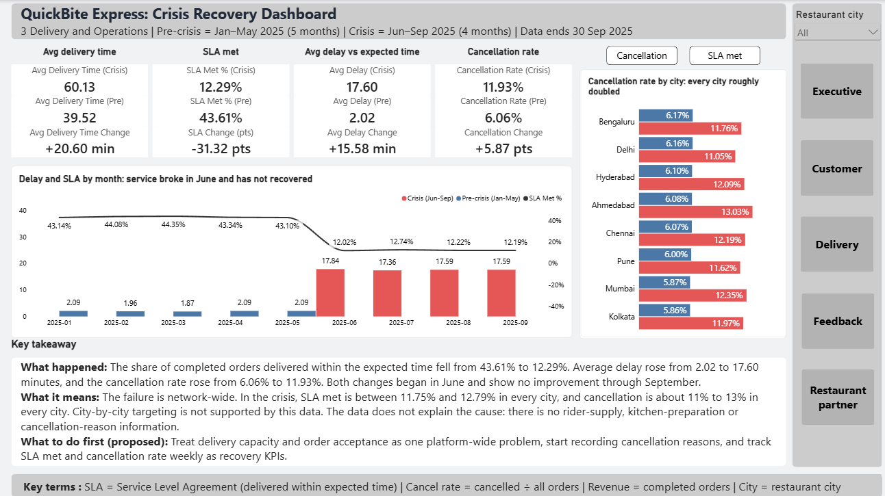
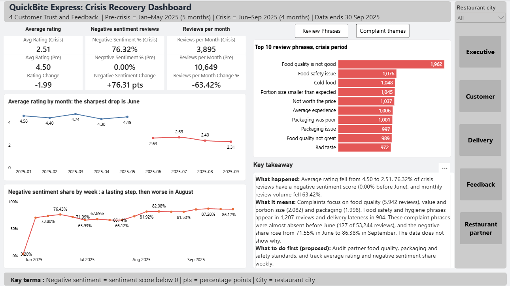
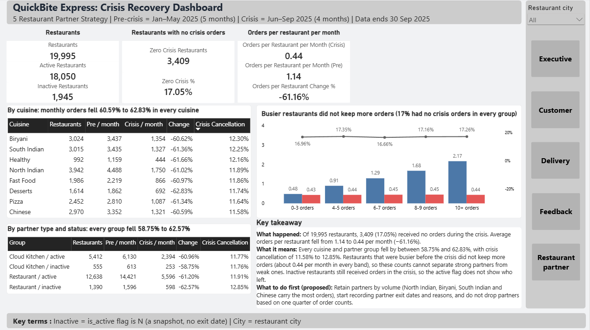

# QuickBite Express: Crisis Recovery Analysis

An end-to-end analysis of a food-delivery startup after a sudden crisis in June 2025. It goes from raw order, delivery and review data to a five-page Power BI dashboard, a findings report and a recovery plan for management.

   

| | |
|---|---|
| Recovery plan | [docs/QuickBite_Recovery_Plan.pdf](docs/QuickBite_Recovery_Plan.pdf) |
| Findings report (by dashboard page) | [docs/QuickBite_Findings_Report.pdf](docs/QuickBite_Findings_Report.pdf) |

## Contents

[Summary](#summary) | [Business problem](#the-business-problem) | [Data](#data) | [How the work was done](#how-the-work-was-done) | [Key results](#key-results) | [Dashboard](#dashboard) | [Answers to the ten key questions](#answers-to-the-ten-key-questions) | [Recommendations](#what-i-recommend) | [Decisions and definitions](#decisions-and-definitions) | [Data quality](#data-quality-issues-and-how-i-handled-them) | [Power BI model](#power-bi-model) | [Limitations](#limitations) | [What I learned](#what-i-learned) | [How to run it](#how-to-run-it) | [Repository structure](#repository-structure) | [Skills shown](#tools-and-skills-shown)

## Summary

On 1 June 2025 daily orders fell from about 720 to about 310 and stayed there through the end of the data on 30 September. Orders per month are down 61%, revenue per month is down 64%, cancellations nearly doubled, only 12% of deliveries arrive on time, and the average rating dropped from 4.50 to 2.51. About 86% of customers who ordered before June did not order again.

The same pattern appears in every city, customer group and restaurant group. The data shows what happened but not why, so the recovery plan asks first for the missing information to be collected and for service problems to be fixed before discounts are used.

## The business problem

QuickBite Express is a Bengaluru-based food-delivery startup. In June 2025 a viral food safety incident and a week-long delivery outage led to customer backlash, falling orders and ratings, and restaurant partners moving to competitors. Management asked for insights on:

1. Which customers can be recovered, and which need a new approach.
2. How order patterns changed across the phases.
3. Where delivery, cancellations and on-time performance broke down.
4. Which campaigns could rebuild trust.
5. Which restaurant partnerships matter most.
6. What customers say in ratings and reviews.

I took the role of the data analyst who has to answer these questions and recommend actions.

## Data

Eight tables covering 1 January to 30 September 2025 and eight cities. The data is not stored in this repository. See [data/README.md](data/README.md) for the tables, the differences between the metadata and the files, and how to get the data.

| Table | Rows | One row per |
|---|---|---|
| fact_orders | 149,166 | order |
| fact_order_items | 342,994 | order line |
| fact_ratings | 68,842 (68,825 after cleaning) | rated order |
| fact_delivery_performance | 149,166 | order |
| dim_customer | 107,776 | customer |
| dim_restaurant | 19,995 | restaurant |
| dim_delivery_partner | 15,000 | delivery partner |
| dim_menu_item | 342,671 | menu item |

Phases used throughout: **pre-crisis** is January to May (5 months), **crisis** is June to September (4 months). The phases have different lengths, so comparisons use monthly averages.

## How the work was done

| Stage | Tool | What I did | Output |
|---|---|---|---|
| 1. Audit | Python (pandas) | Checked sizes, types, nulls, duplicates, dates, categories, ranges and keys | [docs/data_quality_summary.md](docs/data_quality_summary.md) |
| 2. Cleaning | Excel Power Query | Fixed data types and date formats, removed blank rows, and kept meaningful nulls and zeros | [docs/cleaning_log.md](docs/cleaning_log.md) |
| 3. Analysis | MySQL 8.0 | Integrity checks across tables, then queries for each business question | Results in the findings report and this README |
| 4. Dashboard | Power BI | Data model, calendar table, DAX measures, five report pages | Screenshots below |
| 5. Strategy | Written report | Recovery plan for each finding, with owners, KPIs and checkpoints | [docs/QuickBite_Recovery_Plan.pdf](docs/QuickBite_Recovery_Plan.pdf) |

Each tool had one job. Cleaning was done once in Power Query and was not repeated in SQL or Power BI. Every number on the dashboard was compared against a second calculation (SQL or the raw files) before it was used.

## Key results

| Measure | Pre-crisis (Jan to May) | Crisis (Jun to Sep) | Change |
|---|---|---|---|
| Orders per month (all orders placed) | 22,761 | 8,840 | -61.16% |
| Revenue per month (completed orders) | 7.52M | 2.74M | -63.65% |
| Average order value | 351.89 | 351.30 | about flat |
| Cancellation rate | 6.06% | 11.93% | +5.87 points |
| On-time delivery (SLA met) | 43.61% | 12.29% | -31.32 points |
| Average delay against expected time | 2.02 min | 17.60 min | +15.58 min |
| Average rating | 4.50 | 2.51 | -1.99 |
| Reviews with negative sentiment | 0.00% | 76.32% | n/a |
| Reviews per month | 10,649 | 3,895 | -63.42% |
| Orders per restaurant per month | 1.14 | 0.44 | -61.16% |

Money is in the currency of the data, which I assume is Indian rupees.

**Main findings**

1. **The drop happened on one day.** There were 695 orders on 31 May and 301 on 1 June. There was no week of near-zero orders and no bounce back. The estimated shortfall against the pre-crisis monthly average is about 19.16 million over the four crisis months (an estimate that assumes nothing else would have changed).
2. **Cancellations nearly doubled in every city** (each city rose by 4.9 to 6.9 points).
3. **Delivery got slower everywhere.** About 27,300 of 31,142 completed crisis orders arrived late. Average trip distance did not change (4.49 km and 4.50 km). On-time delivery in the crisis was between 11.75% and 12.79% in all eight cities.
4. **Trust fell and kept falling.** The monthly rating was 2.63 in June and 2.31 in September.
5. **Complaints are mostly about food.** In crisis reviews: food quality 38.14%, general complaints 15.17%, value and portion size 13.36%, packaging 12.82%, food safety and hygiene 7.75%, late delivery 5.80%. Complaint phrases were close to absent before June.
6. **About 86% of earlier customers did not return** (70,970 of 82,862). The rate was nearly the same for every customer group, including the top 5% by spend (3,562 of 4,144 stopped), so past spending and past order counts did not predict who stayed.
7. **Customers did not switch to cheaper orders.** Order value bands barely moved.
8. **Restaurant-level data is too thin to rank partners.** Crisis orders were about 0.44 per restaurant per month whatever the earlier volume, and about 17% of restaurants in every volume group had no crisis orders. No restaurant had the 50 earlier orders the brief asked for (the maximum was 21).
9. **No recovery can be measured.** The data ends on 30 September.

## Dashboard

| Page | Question it answers |
|---|---|
| 1. Executive Overview | How bad is it, and is it getting better? |
| 2. Customer Retention and Recovery | Who did we lose, and which groups can be targeted? |
| 3. Delivery and Operations | Where did service break down? (buttons switch between cancellation and on-time delivery by city) |
| 4. Customer Trust and Feedback | What are customers saying, and has trust recovered? |
| 5. Restaurant Partner Strategy | Which partners matter, and what can the data support? |







Dashboard features: a date table with a Phase column, DAX measures grouped in one measures table, a restaurant-city slicer synced across pages, a separate customer-city slicer on Page 2, navigation buttons on every page, and bookmarks with buttons that switch charts on Pages 3 and 4.

## Answers to the ten key questions

| # | Question | Answer |
|---|---|---|
| 1 | Monthly orders, pre-crisis vs crisis | Monthly average -61.16% (completed orders -63.6%) |
| 2 | Top 5 cities by fall in orders | Chennai (-62.5%), Bengaluru (-61.5%), Kolkata (-61.5%), Hyderabad (-61.1%), Ahmedabad (-61.0%). All eight cities fell between 59.9% and 62.5%. |
| 3 | Top 10 restaurants with 50+ pre-crisis orders | No restaurant qualifies (maximum 21). At a lower cut-off of 10 orders, 1,292 qualify, and the top ten all lost every order. That is not reliable evidence of departure. |
| 4 | Cancellation rate and cities | 6.06% to 11.93%. Largest rises: Ahmedabad, Mumbai, Chennai, Kolkata, Hyderabad. All cities are close. |
| 5 | Delivery time and SLA | 39.5 to 60.1 minutes. SLA met 43.61% to 12.29%. Clearly worse. |
| 6 | Monthly rating | Sharpest drop in June (-1.86 points) |
| 7 | Negative keywords in the crisis | Food quality is not good (1,962), Food safety issue (1,076), Cold food (1,048), Portion size smaller than expected (1,045), Not worth the price (1,037) |
| 8 | Revenue impact | -63.65% per month. About 19.16M shortfall over four months (estimate). |
| 9 | Customers with 5+ orders before the crisis | 50 customers. 42 stopped. 22 of those had an average rating above 4.5. |
| 10 | High-value customers (top 5%) | 4,144 customers, 86.0% stopped. No pattern in city, cuisine, delivery delay or rating separates leavers from stayers. |

## What I recommend

Full detail is in the [recovery plan](docs/QuickBite_Recovery_Plan.pdf). In short:

- **Fix service before discounts.** Record cancellation and late-delivery reasons, review rider supply and restaurant order acceptance, and plan rider numbers by hour.
- **Audit food safety, hygiene, quality and packaging**, starting with the highest-volume cuisines, and only tell customers what has been checked.
- **Set a launch gate for win-back campaigns.** They start only when cancellation and on-time delivery have held at agreed levels.
- **Test every offer** on a random group with a comparison group that receives nothing, and measure the extra orders and the cost per extra order.
- **Do not rank or drop partners on four months of order counts.** Record partner exit dates and reasons, and build a scorecard when there is more data.
- **Measure recovery properly:** refresh the data weekly, set a recovery start date, and judge fixes against a comparison group or the pre-crisis benchmark.

All of these are proposals. The data does not tell us why the problems happened, and the plan says so.

## Decisions and definitions

- **Orders** means all orders placed. **Revenue** counts completed orders only, because cancelled orders have zero amounts.
- **SLA met** means a completed order delivered at or before its expected time.
- **City** is the restaurant's city, because every order has one. 5,053 orders (all cancelled) belong to customers who are missing from the customer table, and customer city and restaurant city agree on only 15% of orders. Page 2 uses customer city, and key results were checked with both.
- **Top 5% of customers** means the 95th percentile of January to May spend.
- **Negative sentiment** means a sentiment score below 0 (76.32% of crisis reviews). Separately, 93.0% of crisis reviews carry one of the complaint phrases. They are two different measures, and each is labelled where it is used.
- **Ratings** are counted by review date, to match the SQL results.

## Data quality issues and how I handled them

| Issue | Handling |
|---|---|
| 17 blank rows in the ratings file | Removed |
| Dates stored as text in three formats | Converted with the right format for each |
| 5,635 orders with no delivery partner (all cancelled) | Kept |
| 11,112 cancelled orders with zero amounts | Kept, excluded from revenue and order value |
| 5,053 orders whose customer is missing from the customer table (all cancelled) | Kept, which is why restaurant city is the main city |
| 36,348 order-item rows with no matching order | Items table not used |
| Menu prices do not match prices on order lines | Menu price not used |
| Customer city and restaurant city agree on only 15% of orders | Used restaurant city, checked key results with customer city |
| Ratings are decimals, review text has only 27 different phrases | Used as given, with limits stated |

The full list is in [docs/data_quality_summary.md](docs/data_quality_summary.md).

## Power BI model

- **Star-style model.** `fact_orders` is the centre. `dim_restaurant`, `dim_customer` and `dim_delivery_partner` connect one-to-many. `fact_delivery_performance` and `fact_ratings` connect one-to-one on `order_id`.
- **Date table** with a Phase column (pre-crisis or crisis), so every chart uses the same period definition.
- **Not used:** `fact_order_items` and `dim_menu_item`, because of the item and price issues above.
- **Page 2** uses a customer-level segment table built by [python/build_customer_segments.py](python/build_customer_segments.py) with the rules described under Decisions and definitions (top 5% by spend, and "stopped" means no completed order from June to September). The table is not connected to other tables.
- **Page 4** adds a phrase-to-theme table ([powerbi/phrase_theme.csv](powerbi/phrase_theme.csv)) that groups the 27 review phrases into themes. The grouping is my own.

Examples of measure logic (DAX):

```
Cancellation Rate = DIVIDE([Cancelled Orders], [Orders])

SLA Met % = DIVIDE([SLA Met Orders], [Completed Orders])

Orders per Month (Crisis) =
DIVIDE(
    CALCULATE([Orders], dim_date[Phase] = "Crisis (Jun-Sep)"),
    CALCULATE(DISTINCTCOUNT(dim_date[Month]), dim_date[Phase] = "Crisis (Jun-Sep)")
)
```

The Power BI file itself is not included, because it contains the project data. The screenshots in [images/](images/) show every page.

## Limitations

- The data ends inside the crisis, so there is no recovery period.
- It has no competitor data, advertising or acquisition costs, campaign history, cancellation reasons, or partner exit dates.
- Review text is limited to 27 fixed phrases, and about half of completed orders are rated.
- Individual restaurants and delivery partners have too few orders to rank. Only 50 customers had five or more completed orders before June.
- Benchmarks in the plan are pre-crisis levels, not forecasts.

## What I learned

- Check how the tables relate before trusting any join. Several of the problems above only show up across tables.
- A check on the numbers is worth the time. A few of my own figures changed after I recalculated them from the raw data (for example, the average rating before June is 4.50).
- A result can look dramatic and mean little. The top ten restaurant declines all showed -100%, and the cause was low volume, not departures.
- A recommendation should say what the data cannot prove.

## How to run it

1. Get the eight CSV files (see [data/README.md](data/README.md)) and put them in `data/`.
2. Run `python/audit.py` (set the folder path at the top) to repeat the data audit. The results are summarised in [docs/data_quality_summary.md](docs/data_quality_summary.md).
3. Clean the files in Excel Power Query following [docs/cleaning_log.md](docs/cleaning_log.md), and export the cleaned CSV files.
4. Create the tables in MySQL 8.0 and load the cleaned files with `python/load_data.py` (set the folder path, the database name, and your MySQL user and password as environment variables).
5. Recompute the figures in the findings report in MySQL or pandas, using the definitions above. Then create the customer segment file: `python python/build_customer_segments.py data customer_segments.csv`
6. In Power BI, load the tables, create the relationships and the date table described above, and rebuild the measures.

## Repository structure

```
.
├── README.md
├── data/               how to get the data (files not included)
├── python/             audit.py, load_data.py, build_customer_segments.py
├── powerbi/            phrase-to-theme mapping
├── docs/               data quality summary, cleaning log, recovery plan, findings report
└── images/             dashboard screenshots
```

## Tools and skills shown

- **Python (pandas):** data audit, loading cleaned files into MySQL, and a customer segmentation script
- **Excel Power Query:** type conversion, locale-aware dates, documented cleaning steps
- **MySQL 8.0:** loading cleaned data from Python, joins, grouping and integrity checks
- **Power BI:** star-style data model, date table, DAX (`CALCULATE`, `SWITCH`, `LOOKUPVALUE`, `DIVIDE`), bookmarks, slicer syncing
- **Analysis:** before and after comparison with unequal periods, noise versus real differences, segmentation, test design with a comparison group
- **Communication:** findings written for a business reader, with limits stated

## Author

[Rahul Dhapodkar] | [LinkedIn](https://www.linkedin.com/in/rahul-dhapodkar/) | [Email: rahuldhapodkar08@gmail.com]

The data itself is not included in this repository.
